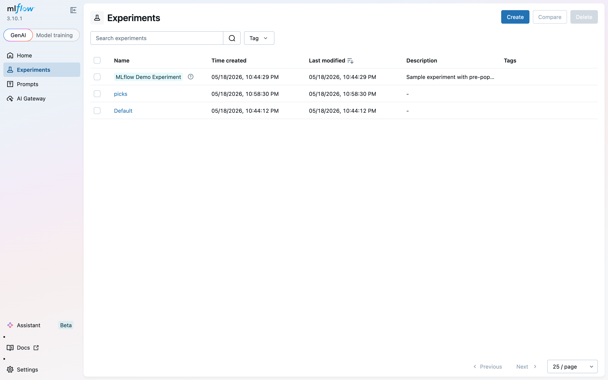
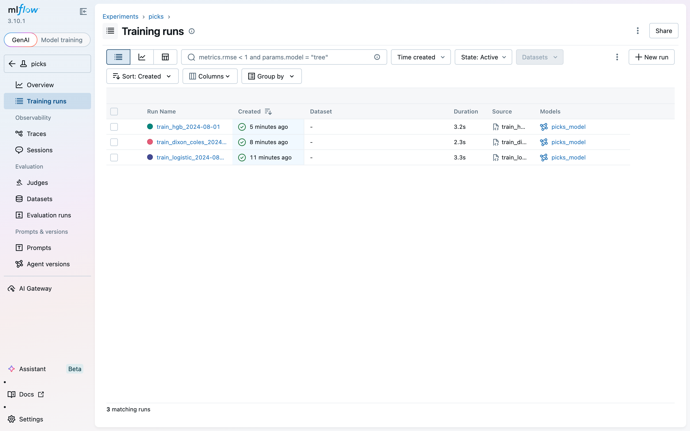
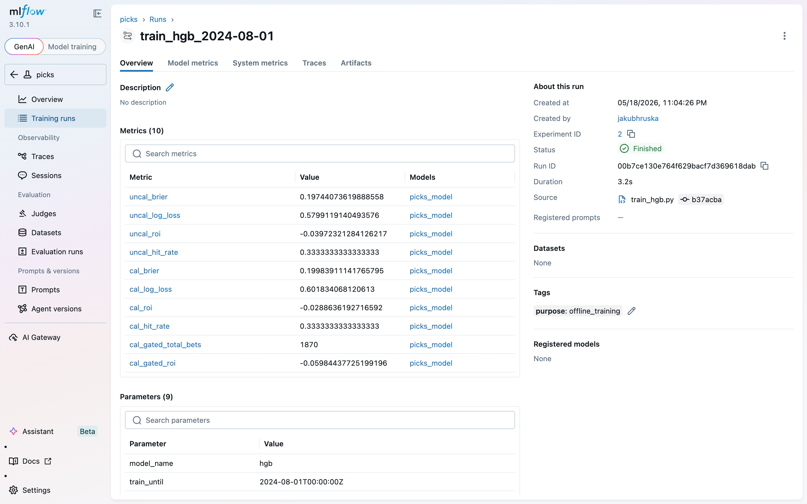
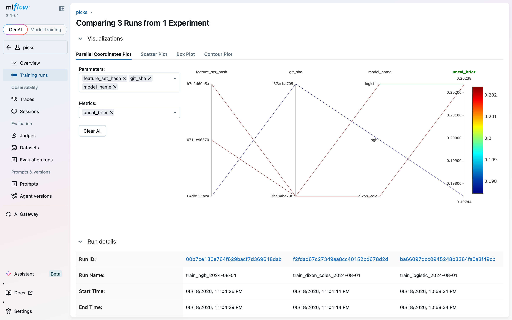
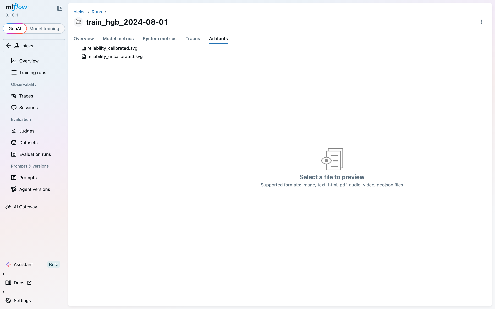

# MLflow lifecycle — operator manual

> **Scope.** How an operator uses MLflow with the FlashScore picks codebase today: local tracking, the model registry as the serving gate ("Phase C-lite"), and how the app surfaces both. Skim the TL;DR, then jump to the section you need.

---

## TL;DR

- **Tracking.** A local MLflow 3 server on `http://127.0.0.1:5050`. Every model fit — offline training scripts, UI-triggered backtests, backfilled old backtests — logs to one experiment (`picks`) with a canonical schema.
- **Registry = serving gate.** Fitted models are logged as `picks_model`. You register a run's model as a version of `picks-<model>` and point the `@champion` alias at it; the API then serves that version (`/predict`, `/picks/upcoming`, refresh-now) and records it on every paper bet (`paper_bets.model_version`). Without a champion — or with MLflow down — serving falls back to the pickles in `$APP_ML_MODELS_DIR`.
- **Backend-owned.** The browser never talks to MLflow. FastAPI exposes `/mlflow/*` (status, runs, registry, promote) with ready-made UI deep links; the app shows MLflow status on Data ops, runs under Model lab › Experiments and the registry under Model lab › Registry. The MLflow UI remains the power-user surface.
- **Never blocks the app.** The API boots without MLflow installed; an unreachable server is re-probed every 60 s; a tracking failure never fails a backtest.

---

## Quick start

### 1. Start the server

```bash
make mlflow
```

This runs (see the `Makefile`):

```bash
uvx --from "mlflow>=3,<4" mlflow server \
  --backend-store-uri sqlite:///mlflow/mlflow.db \
  --artifacts-destination ./mlflow/artifacts --serve-artifacts \
  --host 127.0.0.1 --port 5050
```

- **Port 5050**, because macOS AirPlay Receiver listens on `:5000`.
- **`uvx`** runs MLflow in an isolated environment: the system Python's mlflow install is broken, and the server shouldn't share the app's venv.
- **Proxied artifacts** (`--serve-artifacts`): clients upload through the server, so artifact paths of experiments it creates (`mlflow-artifacts:/<id>`) never point at a particular checkout on disk. Experiments created earlier keep theirs — see [Artifact locations](#artifact-locations-of-existing-experiments).

Backend store `mlflow/mlflow.db` and artifacts `mlflow/artifacts/` are gitignored and relative to where you run `make mlflow`. Run it from the main checkout, not from a worktree you may delete. Keep the terminal open; Ctrl+C stops it.

#### Artifact locations of existing experiments

An experiment's artifact location is fixed when the experiment is created; `--serve-artifacts` doesn't rewrite it. Check yours:

```bash
curl -s 'http://127.0.0.1:5050/api/2.0/mlflow/experiments/get-by-name?experiment_name=picks' \
  | jq -r .experiment.artifact_location
```

`mlflow-artifacts:/<id>` is proxied (good). An absolute path means the experiment predates proxying and clients write straight into that directory. If it lies inside a checkout or worktree, its runs, logged models and registered versions break when that directory is removed. To move to proxied storage:

1. In the MLflow UI, rename `picks` to `picks-legacy` (experiment page › ⋮ › Rename).
2. Restart the API and any running scripts: the experiment id is resolved once per process, so a running API would keep logging into the renamed experiment. The next run creates a fresh `picks` under the server's `--artifacts-destination`.
3. Register a fresh backtest from the new `picks` and move `@champion` to it before you remove the old directory — versions registered from `picks-legacy` read their files from the old path.

### 2. Point the backend at it

| Env var | Default | Meaning |
| --- | --- | --- |
| `MLFLOW_TRACKING_URI` | `http://127.0.0.1:5050` | Tracking + registry server the backend talks to. |
| `APP_MLFLOW_UI_URL` | the tracking URI (if http) | Browser-facing base for deep links, if it differs (reverse proxy, hosted UI). |
| `APP_MLFLOW_DISABLED` | unset | `1` turns every MLflow call into a no-op. |
| `APP_ML_MODELS_DIR` | `reports/` | File fallback for serving (`<label>/model.pkl`). |
| `MLFLOW_HTTP_REQUEST_MAX_RETRIES` / `_TIMEOUT` | `1` / `10` (set by the app if unset) | Keeps a dying server from stalling the backtest worker for minutes. |

### 3. Verify

```bash
curl -s http://127.0.0.1:8000/mlflow/status | jq
```

`reachable: true` and an `experiment_id` mean you're set. The same block appears on **Data ops**. Opening `http://127.0.0.1:5050` lands on the experiments list:



The `picks` experiment is created on first use. Its id depends on the store (it's often `2`, after MLflow's own demo experiment) — the app resolves it by name and builds every link for you.

---

## What gets logged

### Runs

| `purpose` tag | Written by | Model logged? |
| --- | --- | --- |
| `offline_training` | `scripts/train_{logistic,hgb,dixon_coles}.py` | yes (`picks_model`) |
| `walk_forward_backtest` | backtest worker (Model lab › Backtests, `POST /backtest/runs`) | yes for fitted models and analytic baselines; Dixon–Coles backtests log none |
| `backfill` | `scripts/backfill_mlflow_backtests.py` | no — the fitted model no longer exists |
| `scheduled_retrain` | reserved (Phase D) | — |

Tag `has_model` says whether the run carries a registrable `picks_model`. In MLflow 3 the model is a **logged model** attached to the run (UI: the run's *Logged models* section), not a folder in the run's artifacts.

### Params

Canonical: `model_name`, `train_until`, `market_spec_key`, `sport`, `market`, `feature_set_hash`, `n_features`, `n_train_events`, `git_sha`.

- Training runs add their hyper-parameters (`C`, `max_iter`, `learning_rate`, `max_depth`, `l2_regularization`, Dixon–Coles `xg_weight`, `ewma_half_life`, `home_advantage`, `rho`, `temperature`, …) plus `calib_until`, `min_edge`, `kelly_fraction`, `label`.
- Backtests add `test_until`, `min_edge`, `kelly_fraction`, `force_bets`, `scope_size` (number of leagues).

### Metrics

- Training: `uncal_*` / `cal_*` (Brier, log loss, ROI, hit rate, gated bets/ROI).
- Backtests: `n_bets`, `n_test_events`, and — only when bets were placed — `hit_rate`, `roi`, `brier`, `log_loss`, `max_drawdown`, `return_per_bet`, `rmse_per_bet`, `sharpe_adjusted`.

Two honesty rules:

- **Undefined is not zero.** With no bets the rate metrics are absent, not `0`.
- **No CLV for archive backtests.** Backtests take the closing price, so closing-line value is undefined; `mean_clv` is not logged and the run is tagged `clv_available=false`.

`return_per_bet`, `rmse_per_bet` and `sharpe_adjusted` are computed on **unit-stake** returns (per bet: `price − 1` won, `−1` lost, `0` void; `R_p = 1 + mean`, `RMSE = √mean(r²)`, `Sharpe = (R_p − 1)/RMSE`), independent of Kelly sizing — so they rank selection quality, not staking aggressiveness. Backtests completed before this change stored a Kelly-scaled `sharpe_adjusted` in SQLite; backfilled runs recompute it on unit stakes, and `backfill_mlflow_backtests.py --normalize-sqlite` rewrites the stored values.

The `backtest_runs` row follows the same rules: undefined metrics are stored as `NULL` (rate metrics of a run without bets, `mean_clv` of archive backtests), and the API serves zero-bet rows from older versions as `null` too.

### Artifacts

`reliability.svg` (backtests), `reliability_{uncalibrated,calibrated}.svg` (training), and the `picks_model` logged model:

- `artifacts/model.pkl` — the fitted object (`TrainedLogistic`, `TrainedHGB` — for `hgb_pca` its PCA preprocessor travels inside — Dixon–Coles rates, or `None` for analytic baselines),
- `artifacts/meta.txt` — the model name,
- `code/app/` — the app package (so the pickle resolves anywhere), pinned pip requirements, and the expected input/output columns in the model metadata (no enforced signature: count features arrive as int64 or float).

---

## Registry workflow

### Naming

| App model | Registered model | Servable from the registry |
| --- | --- | --- |
| `logistic` | `picks-logistic` | yes |
| `hgb` | `picks-hgb` | yes |
| `hgb_pca` | `picks-hgb_pca` | yes |
| `dixon_coles` | `picks-dixon_coles` | **no** — needs per-team rates the artifact doesn't bundle; served from `$APP_ML_MODELS_DIR` |
| `market_implied`, `vig_included` | `picks-…` | no (analytic baselines, never served) |

Aliases: **`@champion`** is what serving loads; **`@challenger`** marks the version you're evaluating next. `@champion` is refused for non-servable models.

### 1. Produce a candidate

Run a backtest from **Model lab › Backtests** (or `POST /backtest/runs`). When it completes, the worker logs the MLflow run including the fitted model, and the run gets an MLflow link. Training scripts work too:

```bash
PYTHONPATH=. APP_STORAGE_DB_PATH=$PWD/data/flashscore_snapshots.sqlite3 \
  MLFLOW_TRACKING_URI=http://127.0.0.1:5050 \
  python scripts/train_logistic.py --train-until 2024-08-01T00:00:00Z --C 0.5
```

Prefer registering **backtest** runs: they carry the evidence you promote on (ROI, Sharpe-adjusted, Brier, `n_bets`, test window).

### 2. Register it

From the backtest's page (**Register model**), or:

```bash
curl -s -X POST http://127.0.0.1:8000/mlflow/registry/register \
  -H 'content-type: application/json' \
  -d '{"run_id": "<mlflow run id>", "alias": "challenger", "description": "C=0.5, 2024-08 cut"}'
# -> {"name": "picks-logistic", "version": "3", "alias": "challenger", "reloaded": false}
```

The run must have a `picks_model` (`has_model=true`); backfilled runs can't be registered.

### 3. Promote to champion

From **Model lab › Registry** (the confirmation shows the version's evidence and that serving will switch), or:

```bash
curl -s -X POST http://127.0.0.1:8000/mlflow/registry/picks-logistic/aliases \
  -H 'content-type: application/json' -d '{"version": "3", "alias": "champion"}'
# -> {..., "alias": "champion", "reloaded": true}
```

Moving `@champion` reloads the served models at once (`reloaded: true`). From then on new paper bets from that model record `model_version = "3"`. Roll back by pointing `@champion` at the previous version; remove it (`DELETE /mlflow/registry/picks-logistic/aliases/champion`) to fall back to the file model.

### 4. Check what's served

**Data ops** lists each served model with `source` (`registry` / `file`), version, source run and load time. API: `GET /ops/status` (`models`) or `POST /ml/reload`, which re-resolves everything and returns the list.

### API reference

| Endpoint | Returns |
| --- | --- |
| `GET /mlflow/status` | `MlflowStatus` — enabled, reachable, tracking/UI URLs, experiment id, error |
| `GET /mlflow/runs?purpose=&model=&limit=` | runs (newest first) with `has_model`, registered versions, deep links |
| `GET /mlflow/runs/{run_id}` | one run (404 unknown) |
| `GET /mlflow/registry` | every `picks-*` model: aliases, versions with source-run metrics, `servable` |
| `POST /mlflow/registry/register` | `{run_id, alias?, description?}` → new version |
| `POST /mlflow/registry/{model}/aliases` | `{version, alias}`; `champion` reloads serving |
| `DELETE /mlflow/registry/{model}/aliases/{alias}` | removes an alias; `champion` reloads serving |
| `POST /ml/reload` | re-resolve served models → `{models: ServedModel[]}` |
| `POST /backtest/runs/{id}/cancel` | cancel a queued/running backtest |

Contracts: `frontend/src/types/mlflow.ts`, `frontend/src/types/ops.ts`. With MLflow disabled or unreachable the GETs return 200 with `status.reachable=false` and empty lists; mutations return 503 with the reason.

---

## Serving resolution

At startup (and on every reload) `app/ml/serving.py` resolves each model independently:

1. **Registry** — for `logistic`, `hgb`, `hgb_pca`: download `picks-<model>@champion` and unpickle `artifacts/model.pkl` (no pyfunc at serve time). A broken version is logged and skipped.
2. **File fallback** — if MLflow is disabled/unreachable or there's no champion: `$APP_ML_MODELS_DIR/logistic_phase3a/model.pkl`, `hgb_phase3b/model.pkl`. `hgb_pca` has no file fallback.
3. **Dixon–Coles** — always `$APP_ML_MODELS_DIR/dixon_coles_phase3c/` (rates + config).

A model with neither a champion nor a file is simply not served; Data ops warns when nothing is.

The served set is resolved once per process and shared by `/predict`, `/picks/upcoming` and refresh-now's predict stage. Moving or removing `@champion` through the API reloads it; anything else doesn't — a retrain that writes a new pickle to `$APP_ML_MODELS_DIR`, or an alias changed directly in the MLflow UI, takes effect after `POST /ml/reload` (or an API restart).

`scripts/record_picks.py` uses the same resolution and prints which source each model came from.

---

## Backfill old backtests

Backtests that ran before MLflow logging (or while it was down) have no `mlflow_run_id`. To log them:

```bash
PYTHONPATH=. APP_STORAGE_DB_PATH=$PWD/data/flashscore_snapshots.sqlite3 \
  MLFLOW_TRACKING_URI=http://127.0.0.1:5050 \
  python scripts/backfill_mlflow_backtests.py --dry-run     # list what would be logged
python scripts/backfill_mlflow_backtests.py                  # (same env) log + write ids back
```

Each completed row becomes a `purpose=backfill` run: params and metrics from the row, unit-stake Sharpe recomputed from `backtest_bets`, the reliability chart, original start/end times — and no model. The new run id is written to `backtest_runs.mlflow_run_id`. Re-running is safe: linked rows are skipped, and a fully logged run whose write-back was lost (crash) is re-linked instead of duplicated. A run that fails half-way is deleted and its row stays pending; the script exits `1` and stops early if the server went away.

`--normalize-sqlite` also rewrites the metrics stored on every completed row (not only unlinked ones) to the definitions new backtests persist, so the app's runs table compares like with like: `sharpe_adjusted` on unit stakes (older rows hold NULL or a Kelly-scaled value), rate metrics `NULL` for runs without bets, `mean_clv` `NULL` when every bet was priced at the close. Combine it with `--dry-run` first to see each change. It needs no MLflow server and doesn't touch MLflow: runs logged before unit-stake Sharpe keep their Kelly-scaled `sharpe_adjusted` (and `mean_clv = 0`) there, so for those rows the Registry's source-run metrics and the app's runs table can differ.

---

## Browsing in the MLflow UI

Open the `picks` experiment and its **Training runs** tab (the Overview tab is MLflow's GenAI landing page):



A run's page shows metrics, the canonical params and the `purpose` tag:



Select 2+ runs and **Compare** for a parallel-coordinates view across params and metrics:



Run artifacts hold the reliability SVGs:



Useful search filters:

| Goal | Query |
| --- | --- |
| Only walk-forward backtests | `tags.purpose = "walk_forward_backtest"` |
| Registrable runs | `tags.has_model = "true"` |
| Only hgb runs | `params.model_name = "hgb"` |
| Profitable backtests | `tags.purpose = "walk_forward_backtest" and metrics.roi > 0.02` |
| One training cutoff | `params.train_until = "2024-08-01T00:00:00Z"` |

Cross-jumping: in the app every backtest links to its MLflow run (`mlflow_ui_url`); in MLflow the `backtest_run_id` tag is the app's run id (Model lab › Backtests › that id).

---

## Failure behaviour

| Situation | What happens |
| --- | --- |
| `APP_MLFLOW_DISABLED=1` | All MLflow calls are no-ops; serving uses files; `/mlflow/*` GETs report `enabled=false`. The pytest suite sets this. |
| Server unreachable | `GET {uri}/health` (2 s timeout) fails; logging is skipped and the result cached for 60 s, then re-probed. Logging resumes by itself — no restart. Backtests complete and persist to SQLite without an MLflow link (backfill later). |
| Server dies mid-log | The failed call is classified by re-probing: connectivity → gated for 60 s; a healthy server → the error is about the data, logged as a warning, the MLflow run is marked FAILED, the next run proceeds. A completed backtest is never flipped to failed by MLflow. |
| `mlflow` not importable | The API still boots (imports are lazy); `/mlflow/status` reports the import error. |

---

## Troubleshooting

| Symptom | Cause | Fix |
| --- | --- | --- |
| Port 5000 answers with an AirPlay/`403 Forbidden` page, or `make mlflow` on :5000 says "address in use" | macOS AirPlay Receiver owns :5000. | Use :5050 (the default everywhere now), or disable AirPlay Receiver in System Settings › General › AirDrop & Handoff. |
| `mlflow` from the system Python crashes on import / `mlflow server` fails | The system interpreter's mlflow install is broken. | Use `make mlflow` (uvx, isolated). For scripts use the project venv. |
| `make mlflow`: "address already in use" on :5050 | A previous server is still running. | `lsof -ti:5050` then `kill <pid>`. |
| Data ops shows MLflow unreachable | Server not running or wrong `MLFLOW_TRACKING_URI`. | Start it; the backend re-probes within 60 s. |
| Backtest completed but has no MLflow link | MLflow was down/disabled when it finished. | `scripts/backfill_mlflow_backtests.py`. |
| Register returns 400 "has no 'picks_model'" | Backfilled run, Dixon–Coles backtest, or a run logged before models were attached. | Re-run the backtest (or a training script) and register that run. |
| Promote returns 400 "not servable" | `@champion` on Dixon–Coles or an analytic baseline. | Use `@challenger`, or promote a servable model. |
| Data ops shows `source: file` after promoting | Champion failed to load (see backend log `failed to load …@champion`) or registry unreachable at reload. | Fix the cause, then `POST /ml/reload`. |
| New picks still come from the old model after a retrain | The served set is cached per process; only API alias changes reload it. | `POST /ml/reload`. |
| New runs land in `picks-legacy` after renaming `picks` | The API resolved the experiment id before the rename. | Restart the API. |
| Experiment links open the wrong experiment | Old frontend builds hard-coded `experiments/1`. | Links now come from the backend (`APP_MLFLOW_UI_URL`); `NEXT_PUBLIC_MLFLOW_URL` is no longer used. |
| "MLflow Demo" experiment with sample runs | Created by MLflow 3 itself. | Harmless; delete it in the UI if you like. |

---

## Files

| Path | Purpose |
| --- | --- |
| `app/ml/tracking.py` | All MLflow writes; reachability gate; `get_status()`; deep-link helpers. |
| `app/ml/pyfunc_wrapper.py` | `PicksModelWrapper` + `save_picks_model` (the `picks_model` format). |
| `app/ml/registry.py` | Register / alias / list / champion helpers. |
| `app/ml/serving.py` | Champion-first model loading with file fallback; reloadable served set. |
| `app/routes/mlflow.py` | `/mlflow/*` and `/ml/reload`. |
| `app/services/backtest_manager.py` | Backtest worker; logs each completed run (with its fitted model). |
| `scripts/train_*.py` | Offline training runs. |
| `scripts/backfill_mlflow_backtests.py` | Log pre-MLflow backtests. |
| `Makefile` | `make mlflow`. |
| `mlflow/` | Local server state (SQLite + artifacts). Gitignored. |

## What's next

- **Phase B** — hosted MLflow (Postgres backend, S3-compatible artifacts, auth). Point `MLFLOW_TRACKING_URI` / `APP_MLFLOW_UI_URL` at it; code paths don't change.
- **Dixon–Coles in the registry** — bundle team-latest rates + config into its artifact so it can be served from `@champion`.
- **Phase D** — scheduled retraining (`purpose=scheduled_retrain`), MLproject reproducibility, KPI-gated promotion.
